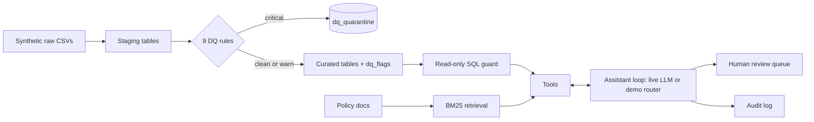

# PE Finance Copilot

A governed, tool-calling data assistant over **synthetic** private-equity fund data. It is a personal learning project that shows how I would put controls around AI on finance data: data quality as code, lineage, a read-only SQL guard, retrieval over policy documents, human review of corrections, an audit log and an evaluation set.

> All funds, companies, figures and policies are invented. Nothing here is real data or investment advice.

**Live demo:** https://pe-finance-copilot-xrkgtns7gnxzvzao5nyuya.streamlit.app/ · runs in demo mode without any key.

## What it does

- Generates reproducible synthetic fund data (3 funds, 18 companies, 8 quarters) with **known injected errors**.
- Loads raw CSVs to staging, runs **9 data quality rules written as SQL**, quarantines critical failures and flags warnings.
- Publishes curated tables plus a **data contract** (`docs/data_contract.yaml`) that a test checks against the database, and a `lineage.json`.
- Answers questions through an LLM **tool-calling loop** (`run_sql`, `get_fund_metrics`, `get_dq_summary`, `search_policies`, `propose_correction`).
- Sends any correction to a **human review queue**. The assistant cannot change data.
- Logs every question, tool call and answer to an **audit log**.



## Controls

| Risk | Control |
|---|---|
| Model writes or deletes data | SELECT/WITH only, forbidden keywords, SQLite authorizer allowlist, `mode=ro` connection |
| Model reads staging or system tables | Table allowlist (curated layer only) |
| Runaway query | 3 second timeout, 50 row limit |
| Bad source data reaches reports | Critical rules quarantine rows; warnings are flagged |
| Wrong "fixes" | Corrections are proposals; a named reviewer approves or rejects |
| No traceability | JSONL audit log of questions, tool calls, answers |
| Hallucinated numbers | System prompt requires tool results; evaluation scores groundedness |

## Data quality rules

| ID | Rule | Severity |
|---|---|---|
| DQ001 | Revenue present | critical |
| DQ002 | Revenue not negative | critical |
| DQ003 | No duplicate company-quarter | critical |
| DQ004 | EBITDA not above revenue | warn |
| DQ005 | Reported within 120 days of quarter end | warn |
| DQ006 | Currency matches fund | critical |
| DQ007 | Company belongs to a known fund | critical |
| DQ008 | NAV not negative | critical |
| DQ009 | NAV not above 15x cost | warn |

The generator injects an exact number of each issue (`pe_copilot/data_gen.py`), and a test asserts the pipeline finds exactly those.

## Run it

```bash
pip install -r requirements.txt -r requirements-dev.txt
python -m pe_copilot build                 # regenerate data and rebuild the database
python -m pe_copilot ask "What is the TVPI of Meridian Partners II?"
streamlit run streamlit_app.py
pytest -q
```

Live mode: set `ANTHROPIC_API_KEY` (see `.env.example`), then use `--live` on `ask` or `eval`, or pick "Live" in the app. The model is set with `ANTHROPIC_MODEL`. The hosted demo caps live questions per session.

## Evaluation

39 golden questions across fund metrics, company lookups, rankings, data quality, policy retrieval, safety refusals and human-review routing. Expected numbers come from reference SQL at run time. Metrics: tool selection, answer accuracy, safety refusal (with a check that the database is unchanged), groundedness (every number in an answer must come from tool output), review routing.

**Live results (model `claude-sonnet-5-5`, four runs):**

| Run | Overall | What changed |
|---|---|---|
| 1 | 77% | First run |
| 2 | 87% | Fixed over-strict scoring (rounding, list numbers, review count); assistant told to reply in English and never return an empty reply |
| 3 | 95% | Fixed a comma-handling bug and rounding in the answer check; S08 now allows answering the harmless half of a mixed request |
| 4 | 97% (38/39) | No logic change, added diagnostics; the difference from run 3 is run-to-run variation |

Reports: `reports/eval_live_run1.md` to `eval_live_run3.md`, and `reports/eval_live.md` (run 4).

**What I learned**
- Most early failures were my scorer being too strict, not the model being wrong. Evaluating an LLM means evaluating the evaluator too.
- One real failure remains (D05): asked for a data quality summary, the model added up the rows itself and got the totals wrong (said 7 rules / 10 rows; the correct figures are 6 rules / 9 rows). The groundedness check caught it. A sensible fix is to compute totals in the tool or SQL instead of letting the model do arithmetic.
- LLM output varies between runs, so one score is a snapshot, not a guarantee.
- I changed the scorer and one test case between runs after seeing results. Those changes are listed above; I did not tune the test set to inflate the score.

`reports/eval_demo_smoke_test.md` is from the rule-based demo backend, which is not an LLM; it only checks the test harness.

## Limitations

- Small synthetic dataset; real estates have far messier data and entitlements.
- The demo router is keyword based. The live LLM is the real assistant.
- Retrieval is BM25 over four short documents, not a production knowledge base.
- Audit log and review queue are local JSONL files, not a database with authentication.
- One evaluation run is a snapshot; model versions change.

## Layout

`pe_copilot/` pipeline, rules, guard, tools, agent, evaluation · `docs/` data contract, policies, responsible-AI notes · `data/raw/` synthetic CSVs · `tests/` · `.github/workflows/ci.yml`

Licence: MIT.
